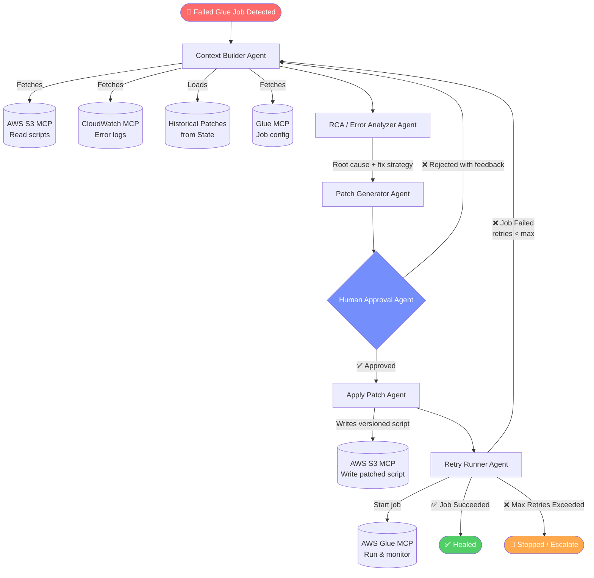

# 🩹 GlueHealer

**Self-healing agentic AI system that automatically diagnoses, patches, and recovers failing AWS Glue ETL jobs.**

GlueHealer uses a LangGraph-orchestrated multi-agent pipeline to fetch error logs, perform root cause analysis, generate code patches, and — with human approval — apply fixes and re-run failed jobs. It learns from historical patches to avoid repeating failed fixes and continuously improves over time.

---

## 🏗️ Architecture


### High-Level Flow

```
Failed Glue Job → Context Builder → Error Analysis → Patch Generation → Human Review → Apply & Retry → ✅ Healed
                       ↑                                    ↓ (rejected)        ↑          ↓ (failed)
                       └────────────────────────────────────────────────────────┘──────────┘
```

### Agents

| Agent | Responsibility |
|---|---|
| **Orchestrator** | LangGraph workflow that coordinates all agents, manages state, and routes decisions |
| **Context Builder** | Gathers all context needed for diagnosis — scripts from S3, error logs from CloudWatch, historical patches from state, and Glue job metadata |
| **RCA / Error Analyzer** | Performs root cause analysis on the error logs using the gathered context. Identifies the failure cause and proposes a fix strategy |
| **Patch Generator** | Produces a unified diff patch based on the RCA output. Consults historical patches to avoid repeating previously failed fixes |
| **Human Approval** | Presents the patch to the user via the UI for review. The user can approve, reject (with feedback), or escalate |
| **Apply Patch** | Creates a versioned copy of the Glue script in S3 with the patch applied. Maintains a rollback trail of previous versions |
| **Retry Runner** | Re-runs the Glue job and monitors execution. Caps retries at a configurable maximum (default: 3) |
| **Observability** | Logs metrics for every healing attempt — success/failure rates, time-to-fix, patch acceptance rates, and retry counts |

### MCP Tool Servers

| MCP Server | Purpose |
|---|---|
| **AWS S3 MCP** | Read original Glue scripts; write patched/versioned scripts |
| **AWS CloudWatch MCP** | Fetch latest error logs and job run metrics |
| **AWS Glue MCP** | Start job runs, poll job status, read job configurations |

### State Management (LangGraph Built-in)

GlueHealer leverages LangGraph's native state management to maintain context across healing cycles:

- **Historical Patches** — Previously generated patches and their outcomes (success/failure), stored in the graph's context state and used by the RCA agent to avoid repeating ineffective fixes
- **Script Versions** — Versioned S3 keys for every patched script, enabling instant rollback
- **Job Healing History** — Per-job timeline of failures, patches applied, and current status

---

## 🔄 Detailed Workflow



### Key Design Decisions

1. **Rejection & failure loops go through Context Builder**: When a human rejects a patch *or* a retried job still fails, the flow routes back to the **Context Builder Agent** — not directly to RCA. This ensures the system re-gathers fresh context (latest logs, updated scripts, new state) before re-analyzing, preventing stale data from poisoning the next attempt.

2. **LangGraph state for historical patches**: Historical patches are stored in LangGraph's built-in context state, keeping patch history co-located with the agent runtime. The RCA agent reads this state to avoid repeating previously failed fixes — no external database required.

3. **Observability agent** *(suggested addition)*: Instrument every healing attempt — success rates, time-to-fix, patch acceptance ratios, and retry distributions — for continuous improvement and operational visibility.

4. **Escalation path** *(suggested addition)*: When max retries are exceeded, escalate to a human operator rather than silently stopping, ensuring no failure goes unnoticed.

5. **Configuration-aware patching** *(suggested addition)*: Extend the RCA agent to consider not just script-level code changes but also Glue job configuration issues (memory allocation, timeout settings, connection parameters, IAM permissions).

---

## 🧰 Tech Stack

| Component | Technology |
|---|---|
| **Orchestration + State** | [LangGraph](https://github.com/langchain-ai/langgraph) — stateful, cyclic agent workflows with built-in context state |
| **LLM** | Configurable — Claude, GPT-4, Gemini, or any LangChain-compatible model |
| **Tool Layer** | [Model Context Protocol (MCP)](https://modelcontextprotocol.io/) servers for AWS service access |
| **User Interface** | React or Streamlit — job selection, patch review, approval/rejection |
| **State Persistence** | LangGraph context state (in-memory, or checkpointed to PostgreSQL/SQLite for durability) |
| **Observability** | CloudWatch Metrics + optional Datadog/Grafana dashboards |

---

## 🚀 Getting Started

### Prerequisites

- Python 3.11+
- AWS credentials with access to Glue, S3, CloudWatch
- An LLM API key (OpenAI, Anthropic, or Google)

### Installation

```bash
git clone https://github.com/your-org/GlueHealer.git
cd GlueHealer
pip install -r requirements.txt
```

### Configuration

```bash
cp .env.example .env
```

Edit `.env` with your credentials:

```env
# AWS
AWS_REGION=us-east-1
AWS_PROFILE=default

# LLM
LLM_PROVIDER=anthropic          # or openai, google
LLM_API_KEY=your-api-key
LLM_MODEL=claude-sonnet-4-20250514

# GlueHealer
MAX_RETRIES=3
REQUIRE_HUMAN_APPROVAL=true
PATCH_HISTORY_TABLE=gluehealer-patches
S3_VERSIONED_SCRIPTS_PREFIX=gluehealer/versions/
```

### Running

```bash
# Start the UI
python -m gluehealer.ui

# Or run headless for a specific job
python -m gluehealer.heal --job-name my-failing-etl-job --run-id jr_abc123
```

---

## 📁 Project Structure

```
GlueHealer/
├── README.md
├── AgenticAI.drawio.png         # Architecture diagram
├── requirements.txt
├── .env.example
├── gluehealer/
│   ├── __init__.py
│   ├── graph.py                 # LangGraph workflow definition
│   ├── state.py                 # Shared state schema
│   ├── config.py                # Configuration loader
│   ├── agents/
│   │   ├── __init__.py
│   │   ├── context_builder.py   # Gathers scripts, logs, history
│   │   ├── rca_analyzer.py      # Root cause analysis
│   │   ├── patch_generator.py   # Generates unified diffs
│   │   ├── human_approval.py    # Human-in-the-loop gate
│   │   ├── apply_patch.py       # Applies patch, writes to S3
│   │   ├── retry_runner.py      # Re-runs Glue job with monitoring
│   │   └── observability.py     # Metrics and logging
│   ├── mcp/
│   │   ├── __init__.py
│   │   ├── s3_server.py         # S3 read/write tool server
│   │   ├── cloudwatch_server.py # CloudWatch log fetcher
│   │   └── glue_server.py       # Glue job runner & monitor
│   ├── ui/
│   │   ├── __init__.py
│   │   ├── app.py               # Streamlit / React entrypoint
│   │   └── components/          # UI components
│   └── utils/
│       ├── __init__.py
│       ├── diff.py              # Unified diff utilities
│       └── versioning.py        # S3 script version management
└── tests/
    ├── __init__.py
    ├── test_rca_analyzer.py
    ├── test_patch_generator.py
    └── test_retry_runner.py
```

---

## 🔐 Safety & Guardrails

| Guardrail | Description |
|---|---|
| **Human-in-the-loop** | No patch is applied without explicit human approval (configurable) |
| **Versioned scripts** | Every patched script is written to a new S3 key — originals are never overwritten |
| **Retry cap** | Maximum retry count prevents infinite loops (default: 3) |
| **Escalation** | Unresolvable failures are escalated to human operators |
| **Historical dedup** | The RCA agent checks past patches to avoid re-applying known bad fixes |
| **Rollback** | Any patched script can be rolled back to a previous version instantly |

---

## 📊 Observability & Metrics

GlueHealer tracks the following metrics for every healing attempt:

| Metric | Description |
|---|---|
| `heal.attempt.count` | Total healing attempts |
| `heal.success.rate` | Percentage of jobs successfully healed |
| `heal.time_to_fix` | Time from failure detection to successful re-run |
| `patch.acceptance.rate` | Percentage of patches approved by humans |
| `patch.rejection.reasons` | Categorized rejection feedback for LLM improvement |
| `retry.count.distribution` | How many retries jobs typically need |
| `escalation.rate` | Percentage of jobs that exceed max retries |

---

## 🗺️ Roadmap

- [ ] **Core agents** — Context Builder, RCA Analyzer, Patch Generator
- [ ] **MCP servers** — S3, CloudWatch, Glue integrations
- [ ] **LangGraph orchestration** — Stateful workflow with conditional routing
- [ ] **Human approval UI** — Streamlit-based patch review interface
- [ ] **Retry & rollback** — Automated retries with version rollback
- [ ] **Observability dashboard** — Grafana/CloudWatch metrics
- [ ] **Auto-mode** — Optional bypass of human approval for high-confidence patches
- [ ] **Multi-job healing** — Parallel healing of multiple failing jobs
- [ ] **Slack/Teams notifications** — Alert channels for approvals and escalations
- [ ] **Fine-tuned models** — Train on historical patches for domain-specific accuracy

---

## 🤝 Contributing

Contributions are welcome! Please open an issue or PR.

## 📄 License

MIT
