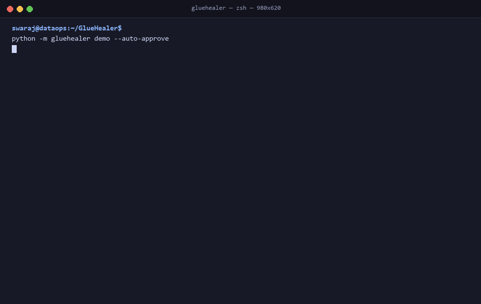

# 🩹 GlueHealer

**Autonomous, self-healing agentic AI system that diagnoses, patches, and recovers failing AWS Glue ETL jobs — with human approval, zero destructive overwrites, infrastructure auto-tuning, and stateful cyclic feedback.**

[](https://github.com/s3arajgupta/App-GlueHealer/actions)
[](https://gluehealer.streamlit.app)


<p align="center">
  
</p>

---

## 💡 The Problem & The Solution

- **The Problem:** In enterprise data platforms, data engineers and on-call teams spend hours triaging repetitive ETL pipeline failures caused by upstream schema drift (`KeyError`), dirty string casts (`ValueError`), division by zero on empty partitions (`ZeroDivisionError`), or infrastructure resource exhaustion (Spark Out-of-Memory / YARN container killed `exit code 137`).
- **The Solution:** GlueHealer autonomously ingests CloudWatch error logs, performs root-cause analysis (RCA), classifies whether a failure is a code bug or an infrastructure bottleneck, generates non-destructive code patches or auto-tunes Glue worker configurations (`WorkerType: G.1X` ➔ `G.2X`, horizontal partition scaling), presents diffs for human review, and safely retries the job. If a patch fails or is rejected with reviewer feedback, the **cyclic state machine** routes back to the Context Builder with cumulative history to produce a refined fix without hallucinating or repeating errors.

---

## ⚡ Quickstart & Live Demo

🌐 **Live Web Application:** [gluehealer.streamlit.app](https://gluehealer.streamlit.app)
*(Interactive control center with pre-loaded production incidents, visual diff reviewer, and human approval gates)*

---

### 1. 🎭 Offline Simulation Demo
Run the end-to-end self-healing cycle locally with built-in simulation (no external API keys required):
```bash
python -m gluehealer demo --auto-approve
```

### 2. 🎨 Local Streamlit Dashboard
Launch the control center web UI locally:
```bash
streamlit run streamlit_app.py
# or
python -m gluehealer.ui
```

### 3. 💻 Local Pipeline Self-Healing
Run the live LLM healing pipeline against local Python ETL scripts:
```bash
# Interactive mode (prompts for [A]pprove / [R]eject / [V]iew diff)
python -m gluehealer sample_jobs/broken_etl.py

# Non-interactive / Headless mode
python -m gluehealer sample_jobs/broken_etl.py --auto-approve
```

### 4. ☁️ AWS Cloud Production Mode
Triage and heal live AWS Glue jobs running in your AWS account:
```bash
# Ingests CloudWatch logs, versions script in S3, auto-tunes resources, retries Glue job
python -m gluehealer --aws --job-name orders-bronze-to-silver

# Target a specific historical failed run ID
python -m gluehealer --aws --job-name orders-bronze-to-silver --run-id jr_8f39b1a03e
```

### 5. 🔙 One-Click Rollback
Instantly revert script pointers and worker configurations to the original baseline or a historical snapshot:
```bash
# Local mode: revert pointer to original baseline
python -m gluehealer rollback

# Local mode: revert to specific snapshot version
python -m gluehealer rollback --to-version v1

# AWS Cloud mode: revert Glue job script location and restore baseline worker type
python -m gluehealer rollback --aws --job-name orders-bronze-to-silver --to-s3-path s3://corporate-datalake-prod/scripts/orders_bronze_silver.py --restore-worker-type G.1X --restore-num-workers 2
```

### 6. 🧪 Run Automated Test Suite
```bash
pytest tests/ -v
```

---

## 🏗️ Architecture & Cyclic Workflow


### Cyclic State Flow

```
Failed Glue Job ──► Context Builder ──► RCA Analyzer ──► Patch Generator ──► Human Review Gate
                          ▲                                                     │
                          │            (❌ Rejected with Feedback)              │
                          ├─────────────────────────────────────────────────────┘
                          │
                          │            (✅ Approved)
                          │                   │
                          │                   ▼
                          │              Apply Patch (S3 v1.py / Glue Config)
                          │                   │
                          │                   ▼
                          │              Retry Runner
                          │                   │
                          │ (❌ Failed)       ▼
                          └─────────── [✅ Healed] or [🛑 Escalate on Max Retries]
```

### Specialized Agents

| Agent | Responsibility |
|---|---|
| **Orchestrator** | LangGraph-style cyclic state machine managing state transitions and loopback routing |
| **Context Builder** | Gathers script source, CloudWatch error logs, metadata, and historical patch critiques |
| **RCA Analyzer** | Pinpoints fault lines, classifies failure type (**Code Bug** vs. **Infrastructure Bottleneck / OOM**), and prescribes fix strategy |
| **Patch Generator** | Produces syntactically valid Python code diffs OR auto-tunes AWS Glue resource configurations (`WorkerType: G.2X`, scaled workers) |
| **Human Approval** | Gatekeeper presenting diffs and configuration changes for approval or collecting reviewer feedback to guide revision |
| **Apply Patch** | Saves non-destructive versioned scripts (`v1.py`, `v2.py`) to S3/local storage and stages updated Glue configurations |
| **Retry Runner** | Re-executes the ETL job with tuned parameters, monitors status, updates telemetry, and enforces retry caps |

---

## 🔐 Production Safety Guardrails

| Guardrail | Engineering Implementation |
|---|---|
| **Zero In-Place Overwrites** | Original scripts are never modified. All patches are saved as versioned artifacts (`s3://.../gluehealer-versions/<job>/v<N>.py`). |
| **Infrastructure Auto-Tuning** | Out-of-memory and YARN kills are handled via resource scaling (`G.1X` ➔ `G.2X`, horizontal scaling) rather than mutating valid script code. |
| **Human-in-the-Loop Gate** | No code or infrastructure update is executed without explicit human authorization (unless `--auto-approve` is passed). |
| **Cyclic Critique Feedback** | Rejections or failed retries re-enter the Context Builder with cumulative history so the LLM learns from mistakes. |
| **Retry & Cost Caps** | Enforces a hard limit on retries (default: 3) to prevent runaway cloud or LLM billing. |
| **One-Click Instant Rollback** | Job configuration and script pointers can be rolled back to the original baseline or historical snapshot at any point (`python -m gluehealer rollback`). |

---

## 📁 Repository Structure

```
App-GlueHealer/
├── .github/workflows/
│   └── ci.yml                   # Automated Pytest CI workflow
├── gluehealer/
│   ├── __init__.py
│   ├── __main__.py              # Unified CLI entrypoint (Local, AWS, and Rollback modes)
│   ├── config.py                # Environment & LLM configuration
│   ├── graph.py                 # LangGraph cyclic state machine
│   ├── state.py                 # Typed shared state schema (code + infrastructure)
│   ├── agents/                  # Multi-agent specialists
│   │   ├── context_builder.py   # Context aggregation & history
│   │   ├── rca_analyzer.py      # Root cause diagnosis & OOM classification
│   │   ├── patch_generator.py   # Unified diff & resource auto-tuning
│   │   ├── human_approval.py    # Human approval prompt gate
│   │   ├── apply_patch.py       # Non-destructive versioning & config updates
│   │   └── retry_runner.py      # Execution & retry monitoring
│   ├── tools/
│   │   ├── interface.py         # Abstract base classes (ScriptStore, JobRunner)
│   │   ├── local/               # Local filesystem & subprocess execution
│   │   │   ├── script_store.py  # Local versioning & rollback engine
│   │   │   └── job_runner.py    # Local subprocess execution
│   │   └── aws/                 # AWS Cloud production adapters
│   │       ├── s3_store.py        # S3 script reader, versioned writer & lister
│   │       ├── cloudwatch_logs.py # Log extractor & Spark noise filter
│   │       └── glue_runner.py     # Glue start_job_run, resource tuning & rollback
│   └── ui/                      # Streamlit interactive application
│       ├── __init__.py
│       ├── __main__.py          # Launcher: python -m gluehealer.ui
│       ├── app.py               # Streamlit control center
│       └── scenarios.py         # Real-world mock incident scenarios (including OOM)
├── sample_jobs/                 # Local demonstration ETL jobs
│   ├── broken_etl.py            # KeyError: 'unit_price' schema drift
│   └── broken_transform.py      # KeyError + ZeroDivisionError
├── tests/                       # Pytest automated test suite
│   ├── test_aws_adapters.py     # S3 URI parsing & CloudWatch noise extraction
│   ├── test_graph_state_machine.py # State machine transitions & escalation
│   └── test_rollback_and_tuning.py # OOM classification, tuning & rollback verification
├── requirements.txt             # Project dependencies
├── streamlit_app.py             # Streamlit Community Cloud entrypoint
└── README.md                    # Project documentation
```

---

## 🛠️ Setup & Configuration

### Prerequisites
- Python 3.11+
- AWS credentials configured (via `~/.aws/credentials` or environment variables) for `--aws` mode
- An OpenRouter, Anthropic, or OpenAI API key (for live LLM mode; offline demo requires no keys)

### Installation
```bash
git clone https://github.com/s3arajgupta/App-GlueHealer.git
cd App-GlueHealer
pip install -r requirements.txt
```

### Environment Settings (`.env`)
```bash
cp .env.example .env
```
Edit `.env`:
```env
# LLM Provider (OpenRouter OpenAI-compatible API)
OPENROUTER_API_KEY=your_api_key_here
LLM_MODEL=nvidia/nemotron-3.5-lightning:free

# AWS Configuration (for --aws mode)
AWS_REGION=us-east-1
AWS_PROFILE=default
S3_VERSIONS_PREFIX=gluehealer-versions

# GlueHealer Tuning
MAX_RETRIES=3
VERSIONS_DIR=job_versions
```

---

## 🗺️ Feature Roadmap

- [x] **Cyclic Multi-Agent State Machine** — Stateful workflow with cumulative context and loopback routing for rejected patches.
- [x] **AWS Cloud Integration** — Boto3 adapters for S3 script versioning, CloudWatch log filtering, and Glue job execution.
- [x] **Interactive Web Control Center** — Streamlit app with scenario simulations, visual diff review, and live human approval gates.
- [x] **Infrastructure Parameter Tuning** — Automated DPU and memory adjustments (`WorkerType: G.1X` ➔ `G.2X`, horizontal scaling) for Out-of-Memory (OOM) failures.
- [x] **One-Click Instant Rollback** — CLI and AWS command (`python -m gluehealer rollback`) to instantly restore script pointers and baseline resource configurations.
- [x] **Automated Test Suite** — Pytest suite with CI workflow validating state transitions, rollback, and cloud tools.
- [ ] **EventBridge Triggers** — Headless Lambda invocation on AWS Glue `FAILED` state change events.

---

## 📄 License

Distributed under the [MIT License](LICENSE).
